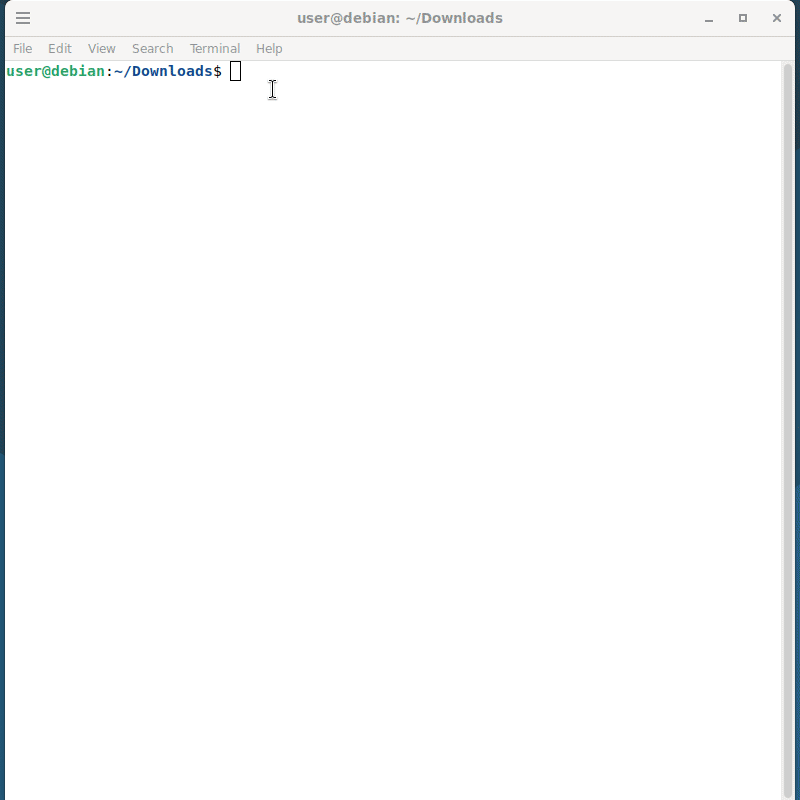
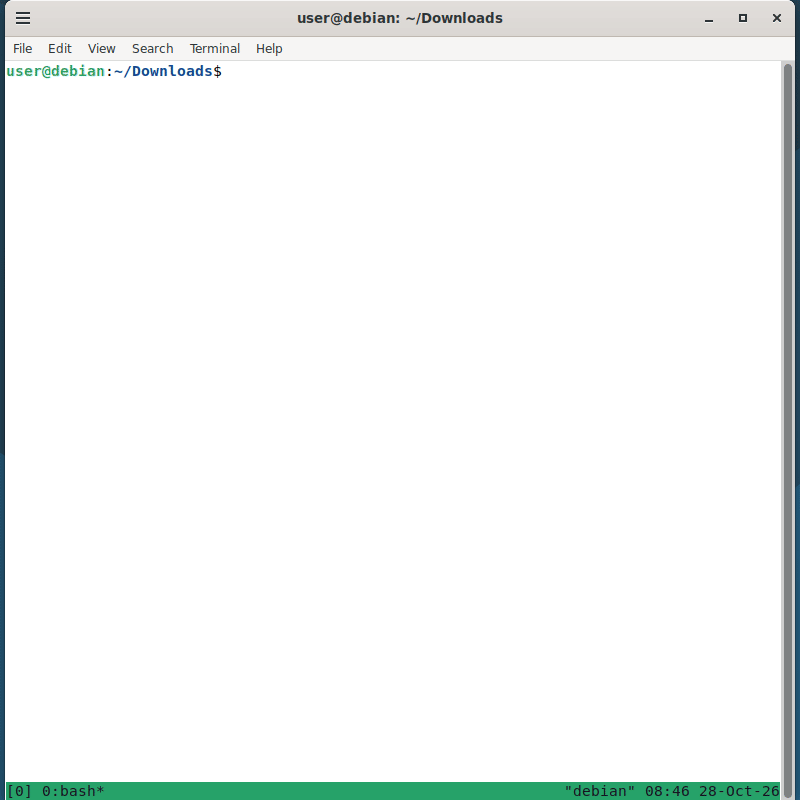

# Stickman Jumper (bash-stickman-jumper)

A retro-style ASCII platformer that turns your Linux Terminal history (thanks to tmux) into a playable game level, jumping over commands.

---

## Demos

### `stickman_v1`

Without the camera following the stickman.



### `stickman_v2`

With the camera following the stickman, allowing you to climb higher.



---

## How to play

1. First, install tmux with:
```
sudo apt install tmux
```

2. Then start tmux with:
```
tmux
```

3. And finally, give execution permission to the bash programs:
```
chmod +x stickman_v1.sh
chmod +x stickman_v2.sh
```

4. And that's it ! You can know enter some `ls` or `cat` commands in order to build your own jump level with your own code !

---

## Author

* [@antoine-pz](https://github.com/antoine-pz) 

---

## Acknowledgements

- **Doodle Jump** for being such a banger after all these years (it was my first inspiration for this game) !

---

## License

This project is licensed under the [MIT License](https://choosealicense.com/licenses/mit/).
Licensed under the MIT License.
See the `LICENSE` file for details.

---

## Feedback

If you have any feedback, please reach out at baruchdesailly@gmail.com.

---

## GitHub Repo

https://github.com/antoine-pz/bash-stickman-jumper
